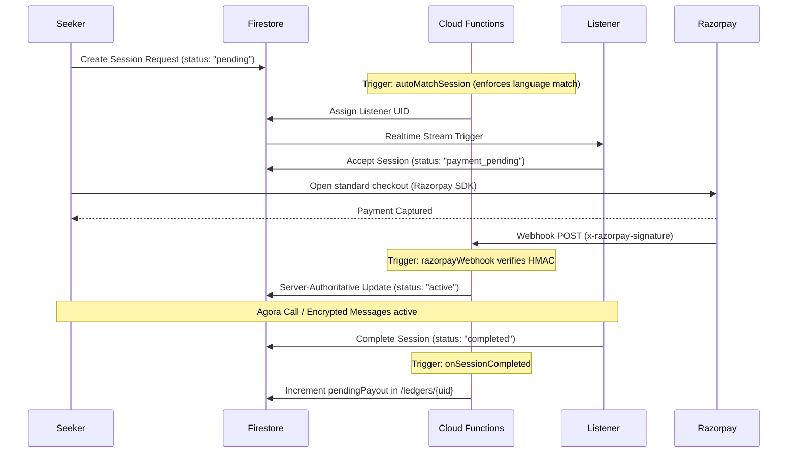

# SafeTalk Seeker-Listener Matching Lifecycle

This page describes the lifecycle of session requests, matching logic, and payment checkout flows.

---

## 1. Interaction Flow Diagram

The state machine is driven by changes to the `sessions` collection in Firestore:

---

## 2. Process Breakdown

1.  **Request Initiation**: A seeker requests a companion. A document is written to `sessions/{sessionId}` with status `"pending"` containing preferred ISO language codes.
2.  **Autonomous Server Matcher**: Firestore trigger `autoMatchSession` executes. It queries available online listeners, strictly requiring that the listener speaks at least one of the seeker's preferred languages (`seekerLanguages`). If matched, it assigns the listener's UID; if no compatible listener is online, it rejects the request gracefully and alerts the seeker.
3.  **Acceptance**: The listener accepts the incoming request. The status updates to `"payment_pending"`.
4.  **Payment Checkout**: Seeker completes the transaction via Razorpay.
    *   *Server-Authoritative Activation*: Payment status transitions to `"active"` **only** via the `razorpayWebhook` Cloud Function following HMAC-SHA256 signature verification of the raw request payload with `RAZORPAY_KEY_SECRET`.
    *   *Rules Enforcement*: Direct client updates attempting to set `status: "active"` or revive `status: "completed"` back to `"active"` are strictly denied by Firestore security rules.
5.  **Agora Voice Session / Encrypted Chat**: Users fetch dynamic token details via `generateAgoraToken` for voice sessions, or establish per-session AES-256-GCM symmetric messaging channels via `ChatCryptoService`.
6.  **Ledger Credit**: Ending the session moves the status to `"completed"`. The Firestore trigger `onSessionCompleted` calculates elapsed minutes and increments `pendingPayout` and writes transaction audit entries in `/ledgers/{listenerUid}`.

---

### Navigation
**◄ [Previous: Overview](file:///d:/Coding/safe_talk/docs/architecture/overview.md)** | **[Table of Contents](file:///d:/Coding/safe_talk/docs/system_architecture_specification.md)** | **[Next: Database Schemas](file:///d:/Coding/safe_talk/docs/architecture/database_schema.md) ──►**
